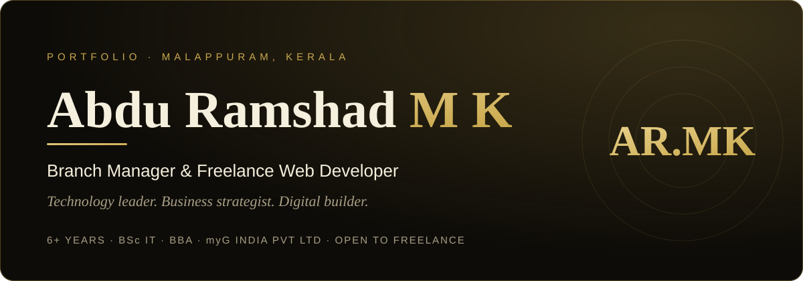
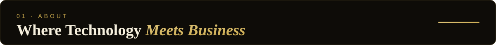
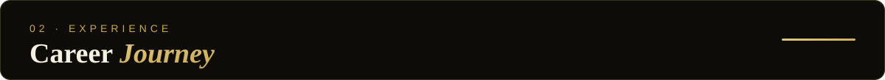
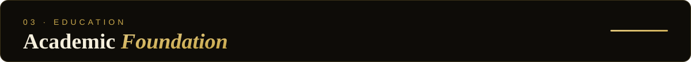
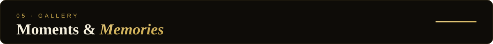
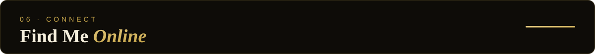

  
  
  
  
  

Hello, I’m **Abdu Ramshad M K**, a results-driven professional from Vaniyambalam, Malappuram, Kerala, with **6+ years** bridging information technology and real-world business.

I hold dual degrees, a **BSc in Information Technology** (University of Calicut) and a **BBA** (Bharathiar University, Coimbatore), because I believe the most effective professionals speak both the language of technology and the language of business.

- 🏢 **Branch Manager at myG India Pvt Ltd**, leading branch operations, a dedicated team, and multi-category sales across mobiles, laptops and home appliances
- 💻 **Freelance Web Developer**, building responsive, performant websites and digital solutions for clients
- 🎓 Started out as a **Computer Faculty** member, then worked as a **Network Engineer** and in field business development at **Paytm**
- 🌱 Always curious about emerging technologies and where IT meets commerce
- 📬 **Open to freelance work.** Reach me at [armkvnbwebsite@gmail.com](mailto:armkvnbwebsite@gmail.com)

| Period | Role | Organisation | Highlights |
| :-- | :-- | :-- | :-- |
| **2023 – Present** | Branch Manager | myG India Pvt Ltd | Directs all branch operations: team leadership, inventory oversight, multi-category sales, and high after-sales service standards |
| **2022 – 2023** | Assistant Branch Manager | myG India Pvt Ltd | Managed billing, inventory control and stock reporting while keeping after-sales service running smoothly |
| **2021 – 2022** | Customer Experience Executive | myG India Pvt Ltd | Consultative, value-driven sales across consumer electronics with strong post-purchase support |
| **Oct 2020 – 2021** | Field Sales Executive | Paytm Services Pvt Ltd | Deployed POS machines and Paytm All-in-One QR solutions, growing the merchant network across Malappuram |
| **Jun – Sep 2020** | Site Support Engineer | Famozone Pvt Ltd, Manjeri | Web and application development, enterprise network configuration, and hardware maintenance |
| **2019 – 2020** | Computer Faculty | Ellora Computer Education, Manjeri | Taught programming, web development principles and productivity software |

| Period | Qualification | Institution |
| :-- | :-- | :-- |
| **2019 – 2020** | Diploma in Computer Applications (including Malayalam and Arabic digital typing) | C-DIT |
| **2016 – 2019** | BSc Information Technology | University of Calicut |
| **2015 – 2018** | Bachelor of Business Administration (BBA) | Bharathiar University, Coimbatore |

  
  
  
  
  
  
  
  
  

| Skill | Proficiency | Focus |
| :-- | :-- | :-- |
| **HTML5** | `█████████░` 90% | Semantic markup, accessibility, structure |
| **CSS3** | `████████▌░` 85% | Responsive layouts, animations, Flexbox/Grid |
| **PHP** | `███████▌░░` 77% | Backend logic, server-side development, WordPress |
| **JavaScript** | `███████▌░░` 75% | DOM, ES6+, interactivity, APIs |
| **SQL / MySQL** | `███████░░░` 70% | Database design, queries, data management |
| **App Development** | `█████▌░░░░` 55% | Mobile, Android, cross-platform |

**Beyond code:** Team Leadership · Branch Operations · Inventory Management · Sales Strategy · Customer Experience · Network Engineering

<table>
  <tr>
    <td width="25%"></td>
    <td width="25%"></td>
    <td width="25%"></td>
    <td width="25%"></td>
  </tr>
  <tr>
    <td align="center">Professional Portrait</td>
    <td align="center">At Work</td>
    <td align="center">Casual Moments</td>
    <td align="center">Business Session</td>
  </tr>
  <tr>
    <td width="25%"></td>
    <td width="25%"></td>
    <td width="25%"></td>
    <td width="25%"></td>
  </tr>
  <tr>
    <td align="center">Tech &amp; Innovation</td>
    <td align="center">Kerala Pride</td>
    <td align="center">Outdoor Moments</td>
    <td align="center">Team &amp; Leadership</td>
  </tr>
</table>

  

  
  
  
  
  
  

  
  

> *“Have a project, a freelance opportunity, or simply want to connect? I respond promptly and look forward to every meaningful conversation.”*

| | |
| :-- | :-- |
| 📍 **Location** | Vaniyambalam, Malappuram, Kerala, India |
| ✉️ **Email** | [armkvnbwebsite@gmail.com](mailto:armkvnbwebsite@gmail.com) |
| 📱 **Phone / WhatsApp** | [+91 95392 96362](https://wa.me/919539296362) |
| 🌐 **Website** | [abduramshad.github.io/armk](https://abduramshad.github.io/armk/) |
| 💼 **Freelance** | Open to work |

  

© 2026 · Crafted with passion in Kerala · Peace be upon you 😊

